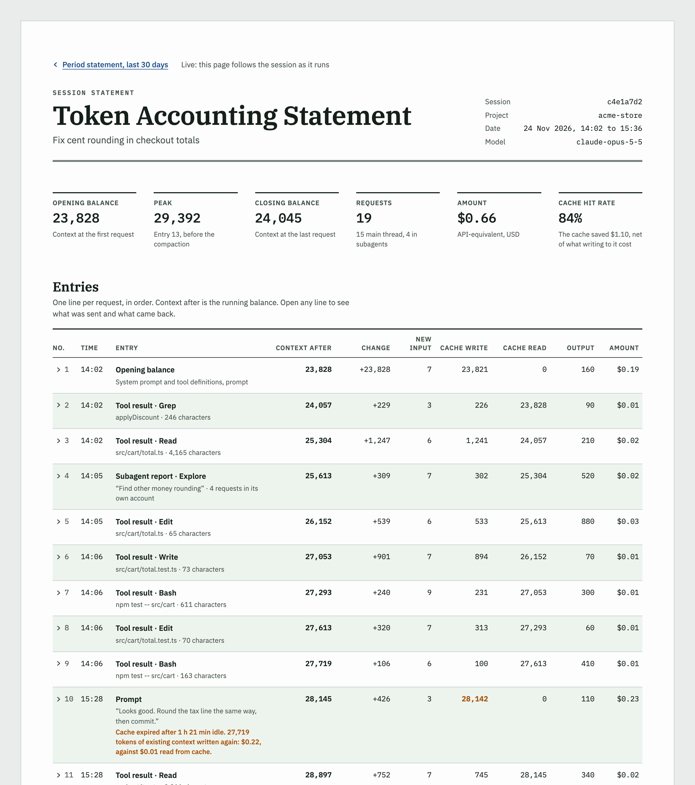
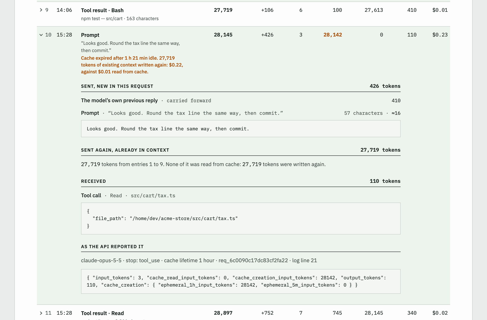
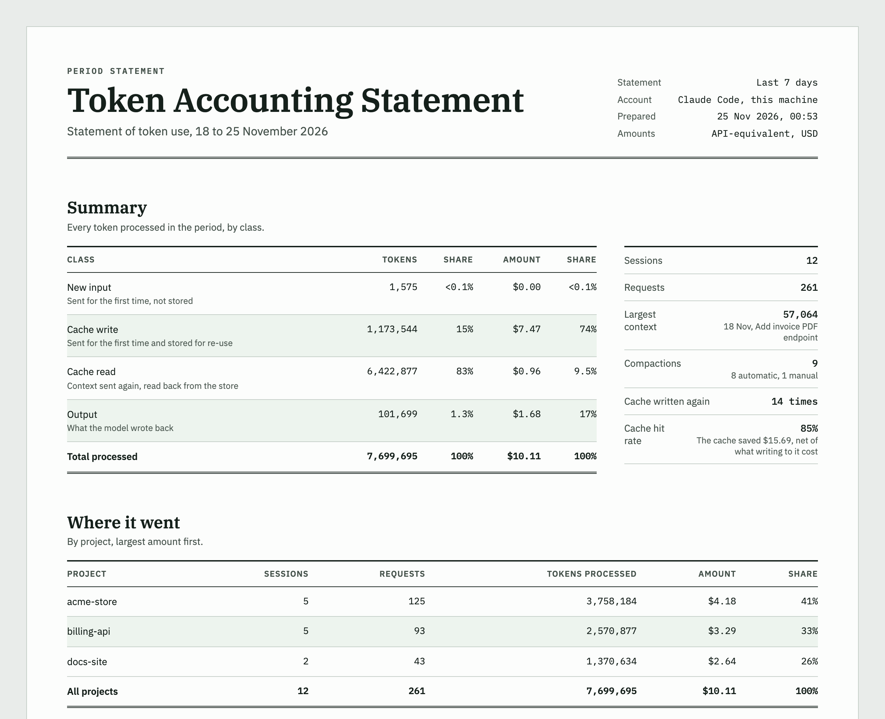
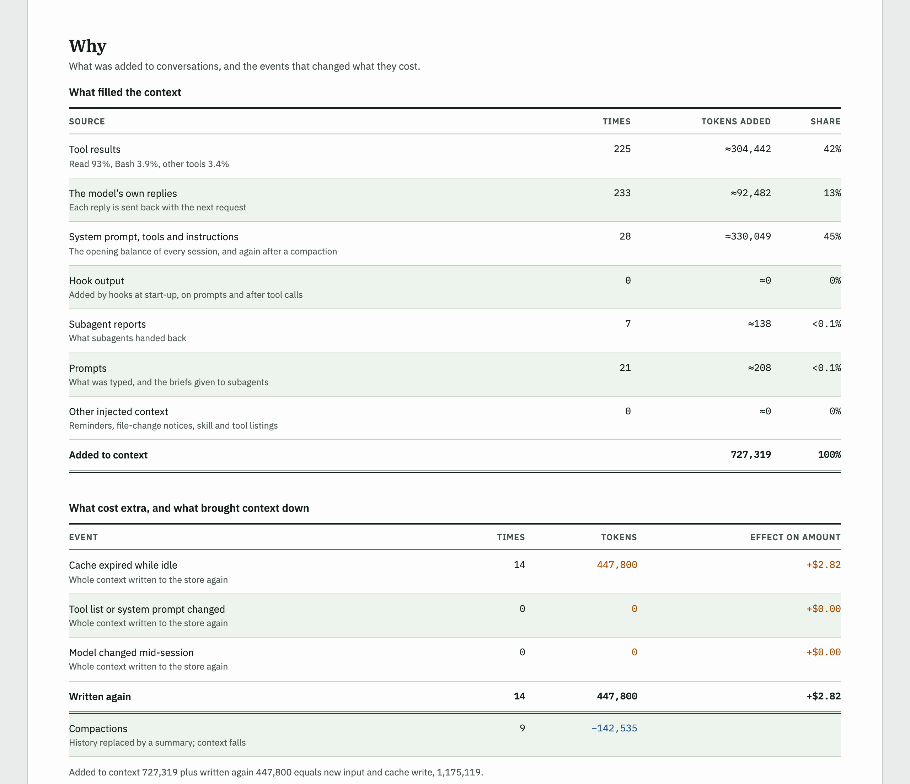

# Token Accounting Statement

**What every Claude Code session spends, itemized like a bank statement.** One line per model
request, the context balance after it, the reason it changed, and what it cost. It stays live
while the session runs, in Claude Code and in your browser.

[](https://github.com/oshricohenme/ai_multi_tool/actions/workflows/validate-plugins.yml)
[](LICENSE)



<sub>All screenshots show made-up demo sessions. Every figure in them is the plugin's own output for those sessions.</sub>

## Why

Claude Code logs every model request on your machine, with the exact number of tokens it used.
Nothing turns those logs into an account of where the tokens went, and on a subscription no
invoice itemizes them either. Tokens translate directly into cost, so this plugin keeps the
books:

- **What was spent.** Tokens per request, session, project, model, agent, tool, day and
  five-hour window, priced at API rates. On a subscription, read the amounts as what the same
  work would cost through the API.
- **How the context moved.** The context size after each request is the running balance.
  Every rise and fall gets its own line.
- **Why.** Each line names its cause: a prompt, a tool result (which tool, which file), a hook,
  a subagent's report, a compaction, or a cache that expired while you were away.
- **What it was.** Open any line to see what that request sent and what came back.
- **Whether it adds up.** Each session closes with a reconciliation against the totals Claude
  Code recorded itself. Anything the logs don't break down goes on one "Not itemized" line.
  Nothing is dropped.

It only reads logs. It sends nothing off your machine, never calls a model (so it spends no
tokens) and never changes a session.

## Contents

- [What you get](#what-you-get)
- [Requirements](#requirements)
- [Install](#install)
- [Use](#use)
- [Reading a statement](#reading-a-statement)
- [Privacy and security](#privacy-and-security)
- [Configuration](#configuration)
- [Uninstall](#uninstall)
- [Limitations](#limitations)
- [Development](#development)
- [License](#license)

## What you get

### In Claude Code: a status line and a live pane

From the first response on, the status line under the prompt keeps a running total:

```
Token statement $0.66 · context 24,045 · 19 requests
```

`/token-statement` opens a pane beside the chat that follows the session, newest request
first. A line that wrote the cache again says why and what that cost:

```
$0.66 API-equivalent · 19 requests
Context now 24,045 · peak 29,392 · cache hit 84%
Subagents: 4 requests in 1 subagent, $0.06
Every request in full, live, in the browser: /token-statement

 No. Time  Entry, newest first                             Change   Amount
  16 15:36 Tool result · Bash                                +152    $0.01
  15 15:36 Prompt                                              +9    $0.01
  14 15:35 Compaction, manual                              −5,658         
  13 15:29 Tool result · Bash                                +137    $0.01
  12 15:28 Tool result · Edit                                +358    $0.01
  11 15:28 Tool result · Read                                +752    $0.02
  10 15:28 Prompt                                            +426    $0.23
           Cache expired after 1 h 21 min idle. 27,719 tokens of existing…
   9 14:06 Tool result · Bash                                +106    $0.01
   8 14:06 Tool result · Edit                                +320    $0.01
   …
```

The status line and the pane update after every response, a subagent's included, and after
each compaction.

### In the browser: the full statement, live

The same command opens the session's full statement in your browser. The page follows the
session as it runs: new lines appear within about two seconds, and any line you opened stays
open.

Open a line to see what the request sent, what was already in context, what came back, and the
usage exactly as the API reported it:



### For a week or a month: the period statement

`/token-statement week` and `/token-statement month` cover every session in the period. You
get a summary by token class with the cache hit rate and what the cache saved, spend by project,
a breakdown by model, agent, skill, plugin, MCP server, tool, day and five-hour window, and one
row per session that opens that session's statement.



Its **Why** section shows what filled the context and what cost extra:



### From a shell

The statement is a plain Node script with no dependencies, and it works with no Claude session
open. From a clone of this repo (or from the installed copy, whose path `claude plugin list`
prints):

```bash
node token-accounting-statement/bin/statement.mjs                       # the last 30 days, as text
node token-accounting-statement/bin/statement.mjs open --since 7d       # the last 7 days, in the browser
node token-accounting-statement/bin/statement.mjs --month 2026-11 --html november.html
node token-accounting-statement/bin/statement.mjs --session <id> --csv  # one line per request
node token-accounting-statement/bin/statement.mjs --help
```

`--json` gives the same figures as JSON.

## Requirements

- **Claude Code.** Tested on 2.1.331. The one-line install below needs 2.1.275 or later.
- **Node.js 20 or later** on your `PATH`. The plugin runs `node`. Tested on Node 22.
- **A web browser** for the full statement. The pane and status line need nothing else.

## Install

**In Claude Code**, run:

```
/plugin install token-accounting-statement --marketplace oshricohenme/ai_multi_tool
```

Then start a new session, or run `/reload-plugins`. On Claude Code older than 2.1.275, add the
marketplace first:

```
/plugin marketplace add oshricohenme/ai_multi_tool
/plugin install token-accounting-statement@ai-multi-tool
```

**From a shell**, the same two steps:

```bash
claude plugin marketplace add oshricohenme/ai_multi_tool
claude plugin install token-accounting-statement@ai-multi-tool
```

By default the plugin is installed for you in every repo (user scope). Add `-s project` to
install it for the current repo and share it with your team through `.claude/settings.json`,
or `-s local` for the current repo only for you.

**With the install script**, which also turns on auto-update for the marketplace:

```bash
curl -fsSL https://raw.githubusercontent.com/oshricohenme/ai_multi_tool/main/install.sh | sh
```

| Flag | Effect |
|---|---|
| (none) | Install for you in every repo (user scope). Removes per-repo installs, which would make it load twice. |
| `--repo` | This repo only, for you (`.claude/settings.local.json`) |
| `--project` | This repo, shared with your team (`.claude/settings.json`) |
| `--keep-repo-installs` | With user scope, keep the per-repo installs |
| `--no-start` | Don't start `claude` at the end |

Pass flags after `sh -s --`, for example `curl -fsSL … | sh -s -- --project`. The script
needs `claude` and `python3`. Read it first if you like: it's [install.sh](install.sh).

**To try it without installing**, load it from a clone for one session:

```bash
git clone https://github.com/oshricohenme/ai_multi_tool.git
claude --plugin-dir ai_multi_tool/token-accounting-statement
```

To check the install, run `claude plugin list`, or type `/token-statement` in a session.

## Use

| Command | Shows |
|---|---|
| `/token-statement` | This session: the live pane in Claude Code, and the full statement in your browser |
| `/token-statement week` | The last 7 days, in your browser |
| `/token-statement month` | This calendar month, in your browser |
| `/token-statement text` | This session as plain text |

The status line needs no command. At the start of each session the plugin also brings its own
record up to date in the background (see [Privacy and security](#privacy-and-security)).

## Reading a statement

| Column | What it means |
|---|---|
| Context after | The running balance: how many tokens the conversation holds after this request |
| Change | How far the context rose or fell since the previous request |
| New input | Tokens sent for the first time and not stored |
| Cache write | Tokens sent for the first time and stored for re-use. A write costs 1.25× input (5-minute cache) or 2× (1-hour cache). |
| Cache read | Context sent again and read back from the cache, at about a tenth of the input price |
| Output | What the model wrote back, thinking included |
| Amount | What the request would cost at API list prices |

Lines to look out for:

- **Opening balance.** The system prompt, tool definitions, CLAUDE.md files and the first
  prompt, written to the cache by the first request.
- **Cache expired.** After an idle gap longer than the cache's lifetime, the whole context is
  written to the cache again. The line says how long the gap was and what the rewrite cost
  compared with reading from the cache. Changing the model or the tool list mid-session does
  the same, and the line says so.
- **Compaction.** The history is replaced by a summary, and the context falls.
- **Subagent report.** What a subagent handed back. Its own requests are in its own account,
  under "Subagent accounts", with their total.
- **Reconciliation.** Itemized figures against the totals Claude Code recorded. "Not itemized"
  covers the requests Claude Code makes for itself (session titles, summaries, safety checks).
  The logs record those as a total only.

Amounts are in USD at the list prices in [`rates.json`](token-accounting-statement/rates.json)
(as of 2026-11-20). They're a yardstick, not a bill.

## Privacy and security

- **What it reads.** Claude Code's logs in `~/.claude/projects`, and in
  `$CLAUDE_CONFIG_DIR/projects` when that is set. It never writes to them.
- **What it writes.** Only to its own folder, `~/.claude/token-accounting/`, with folders
  readable by you only (`0700`) and files likewise (`0600`). It keeps each session's figures
  there so statements outlive Claude Code's cleanup of old logs: numbers and short labels of up
  to 80 characters, never message text.
- **The network.** It makes no outside connections, sends no telemetry and never calls a model.
- **The browser view** comes from a local server bound to `127.0.0.1`. Its address carries a
  random token that changes each time the server starts. Requests without the token, or with
  another `Host` header, are refused. Pages run under a strict Content Security Policy, and
  everything taken from a log is escaped. The server stops itself after 30 minutes without a
  request.
- **Statements can contain anything the logs hold:** prompts, file contents and command
  output, which can include secrets. Treat a saved statement like the logs themselves.
  `--html` files are readable by you only. Add `--no-detail` to make a copy for sharing. It
  leaves out the content behind each line, though a label can still quote the start of a prompt
  or a command.

## Configuration

| Setting | Default | Use |
|---|---|---|
| `rates.json` | API list prices | Change prices, add a model, or apply negotiated prices. Requests on a model with no rate are counted but carry no amount, and the statement says how many. Changes to the installed copy are overwritten when the plugin updates. |
| `TOKEN_ACCOUNTING_HOME` | `~/.claude/token-accounting` | Where the statement keeps its own record |
| `CLAUDE_CONFIG_DIR` | unset | Also read logs from this Claude Code config folder |
| `--tz <zone>` | your local zone | Time zone for times and days, for example `--tz UTC` |
| `--project <name>` | all | Limit a period statement to one project |
| `--root <dir>` | | Read logs from another `projects` folder |
| `--port <n>`, `--idle <minutes>` | any free port, 30 | The local server's port and idle timeout |

## Uninstall

In Claude Code:

```
/plugin uninstall token-accounting-statement@ai-multi-tool
/plugin marketplace remove ai-multi-tool
```

Or from a shell:

```bash
claude plugin uninstall token-accounting-statement@ai-multi-tool
claude plugin marketplace remove ai-multi-tool
```

If you installed it for one repo (`-s project`, `-s local`, `--project` or `--repo`), run
the uninstall in that repo with the same scope, for example `claude plugin uninstall
token-accounting-statement@ai-multi-tool -s project`.

Removing the marketplace also removes the auto-update entry the install script wrote to your
user settings. After a `--project` or `--repo` install, delete
`extraKnownMarketplaces.ai-multi-tool` from that repo's `.claude/settings.json` or
`.claude/settings.local.json`.

Last, delete the statement's own record:

```bash
rm -rf ~/.claude/token-accounting
```

If the local server is running, it stops by itself within 30 minutes. The plugin leaves
nothing else behind.

## Limitations

- **Claude Code's log format is not a public contract** and changes between versions. Missing
  records reduce the detail but don't break the run.
- **Amounts are API-equivalent**, not your bill. Subscription usage limits aren't in the logs,
  so they aren't shown or predicted.
- **Claude Code's own requests** (titles, summaries, safety checks) aren't logged one by one.
  They appear as a single "Not itemized" line.
- **An opened line shows the content as the log recorded it**, not a byte-for-byte copy of the
  request. Thinking text isn't recorded, only its token count.
- **This machine only.** Merge the CSV or JSON exports from several machines to combine them.
- **A resumed session that continues in a new log file** shows up as a second statement.

## Development

```
.claude-plugin/marketplace.json      the marketplace: one plugin
token-accounting-statement/
  .claude-plugin/plugin.json         plugin manifest
  hooks/hooks.json, register.tsx     the mod: /token-statement, the pane, the status line
  bin/statement.mjs                  command line, the statement's own record, the local server
  bin/account.mjs                    the accounting rules: log records in, entries out (pure)
  bin/render.mjs                     the HTML pages and the text statement
  rates.json                         prices
  fonts/                             IBM Plex, embedded in each page
  types/index.d.ts                   the mod's state contract
  test/                              statement.test.mjs (node --test), pane.test.tsx (claude plugin test)
docs/TOKEN-ACCOUNTING-STATEMENT.md   the design: accounting rules, what the logs hold, decisions
```

There's no build step and there are no dependencies. To work on it, load it from your clone with
`claude --plugin-dir token-accounting-statement`. Before sending a change, run the checks CI
runs:

```bash
node --test token-accounting-statement/test/statement.test.mjs
claude plugin test token-accounting-statement
claude plugin validate . && claude plugin validate token-accounting-statement
```

Issues and pull requests are welcome. [CHANGELOG.md](CHANGELOG.md) lists the changes in each
release.

## License

[MIT](LICENSE). The IBM Plex fonts in `token-accounting-statement/fonts/` are under the SIL
Open Font License 1.1 ([OFL.txt](token-accounting-statement/fonts/OFL.txt)).

This project isn't affiliated with Anthropic. Claude and Claude Code are trademarks of
Anthropic.
