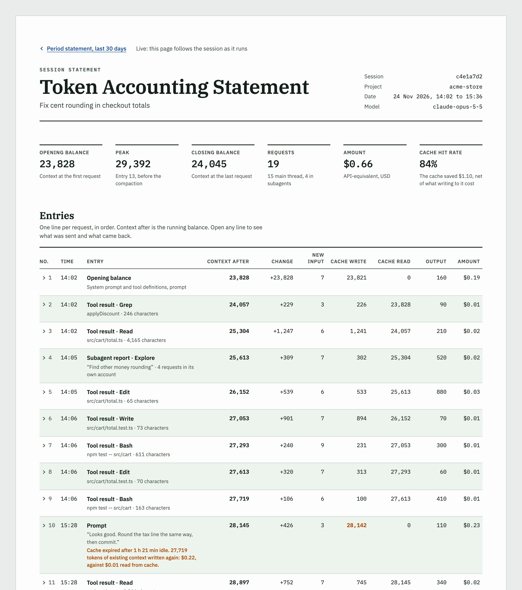
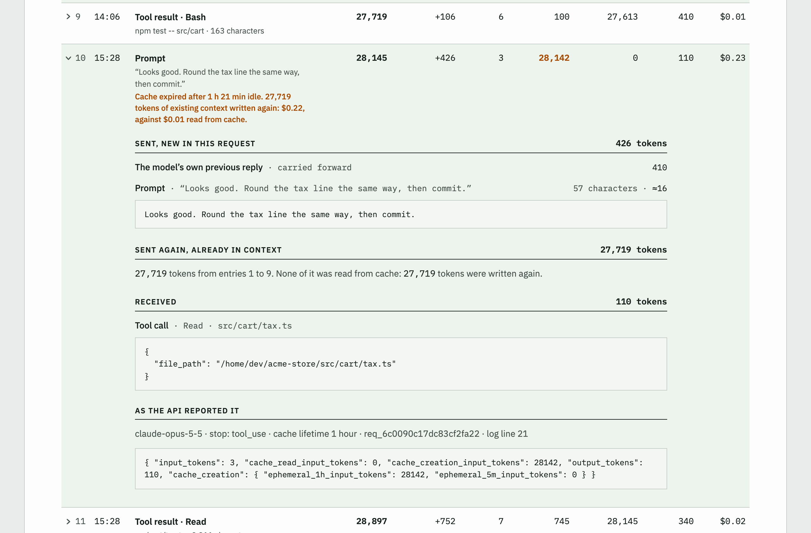

# Token Accounting Statement for Claude Code

Status: built on 2026-11-21 in `token-accounting-statement/`, from the design written on 2026-11-20. First called Ledger; renamed, and made live (see "Live"), the same day. The design
below is kept as written and corrected where the build changed it. "What the build changed
and added" near the end lists every change, and what was taken from similar tools.

## What this is, and why

On a Claude subscription, no invoice ever itemizes what the tokens
went on. Claude Code does write everything down, though: every session is a log file on
disk, and every model request in it records exactly how many tokens it used.

The Token Accounting Statement is a small plugin that reads those logs and prints a statement, laid out like a bank
statement. It answers three questions:

1. **What was spent?** Tokens per request, per session, per project, per period.
2. **How did the context move?** The size of the conversation after every request, with each
   rise and fall on its own line.
3. **Why?** Every line names its cause: a prompt, a tool result, a hook, a subagent, a
   compaction, an expired cache.
4. **What exactly was it?** Click any line and it opens to show the actual content: what
   was sent in that request and what came back.

It only reads the logs. It sends nothing off the machine and never changes a session.

## What you will see

The bank-statement mapping is what makes it easy to read:

| Bank statement | Token accounting statement |
|---|---|
| Transaction | One model request |
| Description | Why the context changed since the previous request |
| Balance | Context size after the request |
| Amount | What the request used, by token class |
| The paper behind a transaction | The actual content sent and received, one click away |
| Closing reconciliation | The statement's total against the total Claude Code itself recorded |

### Session statement

A made-up session, from the demo logs the screenshots use. The accounting is real: this is
the statement's own `--text` output for those logs.

```
 TOKEN ACCOUNTING STATEMENT · SESSION
 Session  Fix cent rounding in checkout totals (c4e1a7d2)    Project  acme-store
 Period   24 Nov 2026, 14:02 to 15:36    Model  claude-opus-5-5
 ════════════════════════════════════════════════════════════════════════════════════════════════════════════════
  No.  Time   Entry                                      Context    Change     Cache       Cache  Output   Amount
                                                           after               write        read
 ────────────────────────────────────────────────────────────────────────────────────────────────────────────────
    1  14:02  Opening balance                             23,828   +23,828    23,821           0     160    $0.19
              System prompt and tool definitions, prompt
    2  14:02  Tool result · Grep                          24,057      +229       226      23,828      90    $0.01
              applyDiscount · 246 characters
    3  14:02  Tool result · Read                          25,304    +1,247     1,241      24,057     210    $0.02
              src/cart/total.ts · 4,165 characters
    4  14:05  Subagent report · Explore                   25,613      +309       302      25,304     520    $0.02
              “Find other money rounding” · 4 requests in its own account
    5  14:05  Tool result · Edit                          26,152      +539       533      25,613     880    $0.03
              src/cart/total.ts · 65 characters
    6  14:06  Tool result · Write                         27,053      +901       894      26,152      70    $0.01
              src/cart/total.test.ts · 73 characters
    7  14:06  Tool result · Bash                          27,293      +240       231      27,053     300    $0.01
              npm test -- src/cart · 611 characters
    8  14:06  Tool result · Edit                          27,613      +320       313      27,293      60    $0.01
              src/cart/total.test.ts · 70 characters
    9  14:06  Tool result · Bash                          27,719      +106       100      27,613     410    $0.01
              npm test -- src/cart · 163 characters
   10  15:28  Prompt                                      28,145      +426    28,142           0     110    $0.23
              “Looks good. Round the tax line the same way, then commit.”
              ! Cache expired after 1 h 21 min idle. 27,719 tokens of existing context written again: $0.22, against $0.01 read from cache.
   11  15:28  Tool result · Read                          28,897      +752       745      28,145     340    $0.02
              src/cart/tax.ts · 2,311 characters
   12  15:28  Tool result · Edit                          29,255      +358       349      28,897      90    $0.01
              src/cart/tax.ts · 63 characters
   13  15:29  Tool result · Bash                          29,392      +137       132      29,255     150    $0.01
              npm test && git commit -am "Round money per line, half-even" · 168 characters
   14  15:35  COMPACTION (manual)                         23,884    −5,658
   15  15:36  Prompt                                      23,893        +9        90      23,800     140    $0.01
              “Open a pull request for this.”
   16  15:36  Tool result · Bash                          24,045      +152       148      23,893     120    $0.01
              gh pr create --fill --base main · 43 characters
 ────────────────────────────────────────────────────────────────────────────────────────────────────────────────
              Main thread (15 requests)                                       57,267     340,903   3,650    $0.60
              1 subagent (4 requests)                                         11,579      29,886     610    $0.06
 ════════════════════════════════════════════════════════════════════════════════════════════════════════════════
              SESSION TOTAL (19 requests)                                     68,846     370,789   4,260    $0.66
 New input 115 · amounts are API-equivalent USD, a yardstick and not a bill
```

In the browser the same statement looks like this:



### Clicking a line

Any line opens in place, to show what that request sent and what came back. Here is entry 10
of the statement above, the prompt after the cache had expired over lunch:



### Period statement

One row per session for a week or a month: date, session title, project, number of requests,
peak context, tokens by class, amount. Totals at the foot. Around it: a summary by token
class with the cache hit rate and what the cache saved; spend by project; a breakdown by
model, by agent, by skill, plugin and MCP server, by tool, by day and by 5-hour usage
window; and the reasons (how much context came from tool results, hooks, prompts and so on,
and how many tokens were re-written because a cache expired).

A request belongs to the period its own timestamp falls in, so a session that crosses
midnight on the last day is split correctly. Subagent logs are never rows of their own: they
count inside their parent session. The foot adds up the sessions' itemized totals and their
"Not itemized" lines, and says how many sessions had no control total. Clicking a session
row opens that session's statement.

### Reconciliation

Every session statement closes with this box. These are the demo session's figures:

```
 RECONCILIATION     Itemized here   Claude Code's own total    Not itemized
 New input                    115                      1,955           1,840
 Cache write                68,846                     68,846               0
 Cache read                370,789                    370,789               0
 Output                      4,260                      4,324              64
 Amount                     $0.66                     $0.66           $0.00
```

"Not itemized" is real spend that the log does not break down: requests the engine makes
for itself (session titles, summaries, the auto-mode safety check). The statement shows it
as one line, so the page still adds up to Claude Code's own total.

## What the logs hold

As checked against Claude Code's logs in November 2026 (Claude Code 2.1).

- **Where.** `~/.claude/projects/<project>/<session-id>.jsonl`, one JSON record per line.
  Subagent logs are in `<session-id>/subagents/agent-<id>.jsonl`, each with a
  `.meta.json` (agent type, description, model). With `CLAUDE_CONFIG_DIR` set, the logs are
  under that folder's `projects` instead; the statement reads both.
- **How much.** A heavy user's logs run to gigabytes and thousands of files, most of them
  subagent logs. Subagents cannot be skipped.
- **Token counts.** Each `assistant` record has `message.usage`: `input_tokens`,
  `cache_creation_input_tokens`, `cache_read_input_tokens`, `output_tokens`, the split
  of cache writes into 5-minute and 1-hour (`cache_creation.ephemeral_5m_input_tokens`,
  `ephemeral_1h_input_tokens`), and `message.model`.
- **Compactions.** A `system` record with `subtype: "compact_boundary"` carries
  `compactMetadata`: `trigger` (auto or manual), `preTokens`, `postTokens`,
  `cumulativeDroppedTokens`, `durationMs`.
- **Causes.** Between two requests the log holds what was added: `user` records (a typed
  prompt, or `tool_result` blocks linked to the tool call by id), and `attachment`
  records typed `hook_success`, `hook_additional_context`, `skill_listing`,
  `mcp_instructions_delta`, `deferred_tools_delta`, `edited_text_file`,
  `queued_command` and others.
- **Claude Code's own total.** A `cost-state` record holds running totals per model
  (tokens by class, thinking tokens, `costUSD`) and `totalCostUSD`. This is the control
  total for the reconciliation box.
- **Request details (newer versions only).** `api-request` records carry `querySource`,
  the model, the cache time-to-live, and a `shapeHash` that changes when the system prompt
  or tool list changes. An `assistant` record points at its request through `requestRef`.
- **Content.** `user` records hold the prompt text and the full content of each
  `tool_result`. `assistant` records hold the response blocks: text, tool calls with
  their full input, and thinking. Thinking text is mostly not recorded: in the sample
  session 98 of 115 thinking blocks were empty, so only their token count is known
  (`output_tokens_details.thinking_tokens`).
- **System prompt and tools (newer versions only).** `api-request-shape` records hold the
  system prompt and every tool definition in full, keyed by `shapeHash` (sample: 3 system
  blocks, 12,333 characters, 24 tool definitions).
- **Not relied on.** `api-request` lists a hash for each message a request added
  (`tail`), and some of those messages are stored as `api-request-blob` records, but
  not all (347 hashes against 154 stored in the sample). This design does not use them.

## Accounting rules

These are the rules every number follows. They are the part to get right.

1. **Count each response once.** One response is written as several records, one per
   content block, and each repeats the same usage. Group by `message.id` and keep the record
   with the most complete usage (the highest output count; the last one on a tie). Counting per record over-counts badly: on the sample session it gave 151.0M
   cache-read tokens against a true 65.3M, and 827K output against 230K. A record with no
   usage, or with all-zero usage, is not a request. No response appears in two log files in this project's logs, but resumed or forked sessions may copy history, so guard against it:
   in a period statement a `message.id` counts once across all files, in the file where
   it appears first.
2. **Context after a request** is `input_tokens + cache_read_input_tokens +
   cache_creation_input_tokens`. Change is that figure minus the previous request's, on the
   same thread. A thread is the main conversation of one log file (records where
   `isSidechain` is false) or one subagent log. The previous request is the previous
   counted response on that thread, in file order.
3. **The row total is exact; the split inside it is an estimate.** The change comes from the
   API's own counts. To say what caused it, first take off the previous response's output
   tokens (the model's own reply, carried forward). Share what is left among the records
   added in between, in proportion to their length in characters. "In between" means written
   in the file, on the same thread, after the previous response's last record and before
   this response's first; parallel tool results all fall there and each takes its share.
   Mark every shared figure with ≈. Never mark a row total.
4. **One entry per request, named for its largest cause**, with the other causes as indented
   lines beneath. The causes: opening balance, prompt, tool result (with the tool's name and
   a short label), hook, skill, other injected context, own reply carried forward, subagent
   report, compaction, clear.
5. **Compaction is its own line**, taken straight from `compactMetadata`: balance falls
   from `preTokens` to `postTokens`, with the trigger and how long after the last request
   it happened.
6. **A fall with no compaction** gets the entry "Trimmed by context management". Do not
   hide it and do not guess further.
7. **Cache re-writes get a reason.** When a request's cache read is under half of the
   context the previous request left, and its cache write is over 10,000 tokens, the context
   was written to the cache again, at the higher write price. Both thresholds are starting
   values to tune on real sessions. Give the first reason that fits: the model changed;
   fast mode was switched on or off; the gap since the previous request on the thread is
   longer than the cache lifetime (1 hour if the thread has made any 1-hour write so far,
   otherwise 5 minutes); `shapeHash` changed (system prompt or tool list); the effort or
   thinking setting changed; otherwise "unexplained". The first request after a compaction
   is never flagged: writing the new, smaller context is its first write, not a re-write.
8. **Subagents are sub-accounts.** Each subagent log is accounted the same way, with its own
   balance. The parent shows one line for the run (requests, tokens, amount) at the time of
   the Agent call, linked by agent id. A session total is the main thread plus its subagents.
9. **Amount is an API-equivalent figure, and says so.** A subscription has no price per
   token, so Amount is what the same tokens cost at API list prices. It is the only honest
   way to add four token classes into one number, since a cache-read token costs a small
   fraction of an output token. Rates live in one file, `rates.json`: per model, the price
   of input, output, cache read, 5-minute cache write and 1-hour cache write. Fill it from
   Anthropic's pricing page when building, not from memory. A model with no rate shows
   tokens and a dash for Amount.
10. **The statement must add up, or say by how much it does not.** The entries sum to the
    session total. The control total is the last `cost-state` record in the file, compared
    per model against the main thread plus its subagents. The difference is shown as it is.
    A negative difference means more was itemized than Claude Code recorded: flag it, never
    clamp it to zero. Where a log has no `cost-state` record (older versions), the box says
    "no control total recorded".

## What a click shows

Every line on every page opens. What it opens to:

- **A request line** shows four blocks, as in the sketch above.
  *Sent, new in this request*: the records from rule 3's window, in order, each with its
  kind, a label, its size in characters, its estimated share of tokens, and its full text.
  *Sent again*: one line giving the size of the context already there, which entries it
  came from, and whether it was read from cache or re-written. It is not repeated.
  *Received*: the response blocks in order. Thinking with no recorded text shows its token
  count and says the text was not recorded.
  *As the API reported it*: request id, model, stop reason, cache lifetime, and the usage
  record exactly as logged.
- **The opening balance** shows the system prompt and the tool definitions from
  `api-request-shape`, and the start-up records (CLAUDE.md, hook output). Where the log
  has no shape record it says "not recorded in this log".
- **A compaction line** shows the summary that replaced the history (the `user` record
  marked `isCompactSummary`).
- **A subagent line** opens that subagent's own account, whose lines open the same way.
- **A session row** on a period statement opens that session's statement.

Three rules for the content:

1. **Shown as logged.** It is the log's record of the content. The exact bytes sent can
   differ slightly, because the engine adds wrappers around some records. The page says so.
2. **Nothing is cut silently.** An item over 100,000 characters shows that much, then a line
   naming the log file and line number where the rest is. An image or other binary content
   is one line with its type and size.
3. **Content is untrusted.** A tool result can contain HTML. Everything from a log is
   escaped before it goes on a page.

## Approaches

**A. A new plugin that reads the logs and prints a statement. Chosen.** One script with no
dependencies does the accounting and produces the statement pages; a thin mod adds the
`/token-statement` command. Reads history only. It is the least code that gives an official-looking, printable
page, and it works with no Claude session open.

**B. A statement page inside a live diagnostics plugin.** Less new code, but such a tool has
many views, and the point here is one plain statement.

**C. Record live through hooks.** The mod API has `turn.step` (usage per response) and
`session.compact` (tokens before and after). Exact reasons at the moment they happen, but
it only covers sessions run after installing, and only where the mod is loaded. The logs
already cover every past session.

## Design

A new folder `token-accounting-statement/`, listed in `.claude-plugin/marketplace.json`.

| File | What it does |
|---|---|
| `token-accounting-statement/bin/account.mjs` | The accounting rules. Pure functions from log records to statement entries and period totals; reads no file. |
| `token-accounting-statement/bin/render.mjs` | The pages and the text version. Markup follows the design canvas; escapes everything that comes from a log. |
| `token-accounting-statement/bin/statement.mjs` | The command line: reads logs, keeps the statement's own record, serves or writes statements, prints the brief the pane shows. Plain Node, no dependencies. |
| `token-accounting-statement/fonts/` | IBM Plex Sans, Serif and Mono (SIL Open Font License, `OFL.txt`), embedded into each page. |
| `token-accounting-statement/rates.json` | The rates table (rule 9). |
| `token-accounting-statement/hooks/register.tsx` | The mod. Registers `/token-statement`, keeps the pane and the status line live, and runs the script. |
| `token-accounting-statement/types/index.d.ts` | The mod's state contract: the brief the pane and the status line show. |
| `token-accounting-statement/.claude-plugin/plugin.json`, `token-accounting-statement/hooks/hooks.json` | Plugin manifest and hook list. |
| `token-accounting-statement/test/statement.test.mjs` | One test file with a small made-up log. Run with `node --test token-accounting-statement/test/statement.test.mjs`. |
| `token-accounting-statement/test/pane.test.tsx` | The mod's test, under `claude plugin test token-accounting-statement`: the pane on every surface, and the refresh after a response. |

**The script.** `node token-accounting-statement/bin/statement.mjs [serve | open | index] [--session <id or log file> |
--since 7d | --month 2026-11] [--project <name>] [--text | --html <file> | --json | --csv | --brief]
[--no-detail]`. With no command it prints a statement; `open` shows it in the browser from
the local server; `index` only brings the statement's own record up to date; `--brief` prints what the pane shows. The accounting is a pure function
from a list of records to a list of entries, so the test needs no real logs. Logs are read
as streams, line by line: one log can run to tens of megabytes, and all of them to gigabytes.

**The cache.** Derived rows are kept per log file under `~/.claude/token-accounting/`, keyed by path,
size and modified time, so only new or changed logs are read again. The cache holds numbers
and short labels (80 characters), never message text. The default period is the last
30 days, so a first run does not read every log. A file's modified time is used only to skip
files too old to hold anything in the period; the requests' own timestamps decide the rest.
The content behind a click is not cached: it is read from the log when a session page is
made.

**The statement.** A session statement is one self-contained HTML page with no scripts (the server's live copy carries one, see "Live").
Ruled lines, right-aligned figures in a fixed-width numeral face, a statement header
(period, project, session, model), entries, subtotals, a double rule over totals, the
reconciliation box, and a short "how to read this" note. Each entry is a native
`<details>` element, so a click opens it with no script, and a saved copy keeps working
offline. It prints to PDF cleanly. The same data prints as fixed-width text for the
terminal, with fewer columns and no content.

**Browsing.** A period statement lists sessions, and a click on one has to produce that
session's statement. Writing every session's statement ahead of time would copy gigabytes
of conversation onto disk, so the script has a `serve` mode instead: Node's own `http`
module, two routes (a period page and a session page), each page made when asked for. An
open session page keeps working after the server stops, since it is self-contained; only
the links on a period page need the server.

**Safety of the server and pages. Required, because the pages hold conversation content.**
- The server listens on 127.0.0.1 only, answers GET only, and checks the Host header.
- Every address carries a random token made new at each start. No token, no page.
- A session id from an address is looked up in the index. It is never joined into a path.
- The server stops itself after a period with no requests.
- Pages carry a Content-Security-Policy that forbids scripts and outside requests
  (`default-src 'none'; style-src 'unsafe-inline'; font-src data:`), on top of the escaping
  rule above. Fonts are embedded in the page as data, so nothing is fetched from outside.
- A session page the server hands out live allows one script, its own, by hash
  (`script-src 'sha256-…'`), and requests to its own address (`connect-src 'self'`). Log
  content is escaped as before, so no text from a log can become script.
- `--html <file>` saves a session statement readable by its owner only (mode 0600).
  `--no-detail` makes a copy with numbers and labels only, for sharing.

**The mod.** `/token-statement` opens the live pane (see "Live"), starts the server if it is not running, opens the current
session's statement in the browser (`open` on macOS; elsewhere it gives the address), and
answers in the chat with a short summary only: totals by token class, the closing context,
and the address. `/token-statement week` and `/token-statement month` open a period statement the same
way. The command is registered with
`$.command.register` in a `session.start` hook and answered by a `command.run` hook that
returns `{ text }`.

The full statement must not be printed into the chat. A command's output is written to the
transcript and may then be carried in the conversation's context (not confirmed for mod
commands), so a long statement there would spend the tokens it is accounting for.
`/token-statement text` prints it anyway for anyone who wants it.

The current session is the log file at `transcriptPath` (from `$.session.info()`) plus
the folder of the same name, which holds its subagent logs. One log file is one statement.
The summary comes from one `$.process.run` of the script, which allows up to ten minutes.
The server belongs to the script, not the mod: `statement.mjs open` starts it in the background
if none is running, records its address in `~/.claude/token-accounting/server.json` (readable by its
owner only), and reuses it afterwards. It stops itself after 30 minutes with no requests.
This way it behaves the same from a plain terminal as from `/token-statement`. The mod also runs
`statement.mjs index` at session start, in the background, to keep the statement's own record
current.

**Live.** While a session runs, its statement follows it in Claude Code and in the browser.

- *The trigger.* The mod hooks `session.measure`, which the engine raises when the session's cost
  or context moves: after each priced response, the main thread's and every subagent's, and after
  a compaction. The hook starts a refresh and returns at once, so it never holds the session up.
- *The refresh.* One run of `statement.mjs --session <transcriptPath> --brief`: the same accounting
  as the pages, printed as a small JSON brief (amount, requests, context now and peak, cache hit
  rate, subagents, the last 40 entries newest first with their flags). It goes into `$.state`.
  Runs never overlap: what lands during a run is picked up by one more run after it. On a
  170-request session with two subagents, a run takes 0.36 s. Nothing calls a model,
  so being live spends no tokens.
- *The status line.* Under the prompt, from the first response on: `Token statement $0.66 ·
  context 24,045 · 19 requests`.
- *The pane.* `/token-statement` opens it: the figures at the top, then the entries newest first,
  each with its time, what it was, the change in context and its amount, and a warning-coloured line
  under any entry that wrote the cache again, saying why and what it cost.
- *The page.* The session page the server hands out asks its own address again every two
  seconds, with the tag it was served with. The tag is a hash of the size and modified time of the
  session's log and its subagent logs, so the server answers 304 with no work until one of them
  changes. Then the page swaps in the new sheet, keeping open lines open. A hidden tab does not
  ask. Pages written with `--html` stay static.

## Goals, non-goals, anti-goals

**Goals.** One statement a person can read top to bottom and trust. Every line has a
reason. Every page adds up.

**Non-goals.** Dashboards, charts, coaching or advice. Predicting
subscription limits. Team roll-up across machines. Editing or cleaning up sessions.

**Anti-goals.** A total that does not add up. An estimate shown as exact. Counting the same
response twice. A dollar figure that reads as a bill. Conversation content leaving this
machine, or being readable by another program on it.

## Constraints and risks

- **Log format is not a public contract.** It differs across Claude Code versions.
  `message.usage` and `compact_boundary` are long-standing; `api-request` and
  `cost-state` are recent. Missing records must lower the detail, not break the run.
- **A statement is as private as the logs.** With the content behind every line it holds
  prompts, file contents and command output, which can include secrets. It is served to this
  machine only, and a saved copy is readable by its owner only. A `--no-detail` copy is
  for sharing, though a label can still quote the start of a prompt or a command.
- **Claude Code's own total is not always a full figure.** Checked on a month of sessions
  with a control total. In 97% of them the statement itemizes about 96% of the output tokens
  Claude Code recorded; the rest is "Not itemized". In the other 3% Claude Code's total is
  *lower* than what its own logs itemize. One traced case: the
  counter was written at 08:59, the session ran on for 15 hours, and the next counter held
  only 88 more minutes of work. Background workflow agents are also missing from the
  parent's counter in some sessions. So the statement never nets the two groups: a period
  statement reconciles only the sessions where the control total covers the itemized
  figures, and reports the others apart, with their count and itemized amount.
- **Subagent logs explain the other models.** On a sample session the subagent logs account
  for 98% of the amount the main thread did not, and the session itemizes 98% of Claude
  Code's own total.

## Decisions made here, open to correction

- A plugin of its own, not a page in an existing tool.
- This machine only. Team totals would need each person to export and a merge step.
- Statements are pages from a small local server that `/token-statement` starts and opens, with a
  short summary in the chat. No live pane in the first version.
- A click shows content as the log recorded it, not a byte-exact copy of the request.
- One log file is one statement. If a resumed session continues in a new file, it shows as
  a second statement.
- Amount is shown, labelled API-equivalent.
- Default period: this session for `/token-statement`, last 30 days for a period statement.

## Left to the builder

Column widths and typography of the statement; exact wording of entry labels; cache file
layout; argument parsing; how the text version drops columns on a narrow terminal; the
server's port and how long it waits before stopping itself.

## What the build changed and added

Built on 2026-11-21. On a real session with 19 subagent logs the statement itemized 98% of
the amount Claude Code recorded; the rest is its "Not itemized" line.

### Changes to the design

- **Three script files, not one.** The rules (`account.mjs`) read no file, so the test runs
  them alone; `render.mjs` makes the pages; `statement.mjs` is the command line and server.
- **The script owns the server.** See "The mod" above.
- **Amounts are whole nano-dollars.** Lines are rounded to the cent for display and totals
  are added before rounding, so a column can differ from its total by a cent or two. The
  page says so.
- **What counts as sent.** An attachment record counts when it carries a `rendered` field,
  which is what was sent to the model. Most hook results (PreToolUse, PostToolUse, Stop)
  carry none and are not counted. Logs older than that field fall back to the hook's output
  for SessionStart and UserPromptSubmit only.
- **The split has a ceiling.** No item is given more than one token per 1.5 characters.
  What is left over is its own line, "Not recorded in the log", unless it is small (50
  tokens or 5% of the rise), when it goes to the largest item. A ToolSearch result takes
  the remainder: it loads tool definitions that the log does not hold.
- **A reply carried back only in part.** When context rises by less than the previous
  reply's size (thinking is dropped, say), the carried share is estimated and marked ≈.
- **Subagent accounts are on the same page**, under the main thread's entries. The line that received
  a subagent's report links to its account.
- **A model's rate is matched exactly**, or with a date after the name. A newer model whose
  name merely starts like an older one gets a dash, not the older price.
- **The period's adding-up sentence has a third term**: context that was already in the
  cache when a conversation opened, or was sent again without a cache read.
- **Rates.** `rates.json` is filled from the Claude API reference bundled with Claude Code.
  Checked against the cost Claude Code recorded per model in each session's last control
  total, over the logs that give the split of cache writes by lifetime: exact on all 544
  sessions for Opus 5.5 (211), Fable 5.1 (183), Sonnet 5.5 (141) and Fable 5.2 (9). For
  Haiku 5.5, with the web-search fee, exact on 205 of 224; the other 19 hold prompts over
  100,000 tokens, which are priced per request at the higher tier and cannot be checked from
  a session total.

### Taken from similar tools

A survey on 2026-11-21 covered ccusage, Claude-Code-Usage-Monitor, CodeBurn, CodeLedger,
cc-token-usage, ccstatusline, claude-hud, Claude Code's own `/usage` and OpenTelemetry
metrics, and Anthropic's usage and cost API. What the logs can support is now in the statement:

| Capability | In the statement |
|---|---|
| Prices beyond a flat table | A fee per web search; the fast-mode price list; the data-residency multiplier; the higher tier for long Haiku 5.5 prompts; a cache-read price per model. All in `rates.json`. |
| Breakdown by model, day and usage window | Period statement, "Breakdown". Days are in local time. Windows follow ccusage's rule: a window opens on the hour of its first request and runs five hours. Each shows its amount per hour. |
| Attribution | By agent (main thread and each kind of subagent), by skill, plugin and MCP server (the tags Claude Code writes on each response), and by tool. |
| Cache economics | Cache hit rate, and what the cache saved net of what writing to it cost, on both statements. |
| Thinking tokens | Exact, from the API's own count, in the summary and on each request. |
| Export | `--csv`, one line per request, and `--json`. |
| Safer counting | The fullest record of a response is kept, not the first; history replayed into another thread or copied into another log counts once; subagent logs whose parent log is gone still count. |
| Books that outlast the logs | Claude Code deletes old logs. The statement keeps its own record of each session's figures under `~/.claude/token-accounting/cache/` (numbers and short labels, no content), brought up to date at each session start. A period statement still counts a session whose log is gone, and marks it. |
| Live view | A status line entry and a pane in Claude Code, refreshed after every response, and a session page in the browser that follows the session. See "Live". |

### Not taken, and why

- **Budgets, alerts, burn-rate forecasts.** These predict or judge. The statement reports what
  happened, as it happens.
- **Anthropic's own usage meter.** It reaches the status line only and is not in the logs.
  The window table is a reading of local logs and says so.
- **Team roll-up, other devices.** The logs are this machine's. CSV and JSON can be merged.
- **Efficiency scores.** That is advice, not accounting.
- **The engine's own requests, itemized.** Session titles, summaries and the like are not in
  the logs. They stay one line, "Not itemized".
- **Negotiated prices, currencies.** Edit `rates.json`.

## The check

`node --test token-accounting-statement/test/statement.test.mjs` on a made-up log must show: two records with one `message.id`
count once; a `compact_boundary` produces one entry with the right fall; a gap longer than
the cache lifetime produces a re-write entry with the idle reason; entries sum to the
session total; an entry's detail holds the tool result's text; a tool result containing
`<script>` comes out escaped; a tool call's input, a JSON tool result and the API's usage show as named fields, tables and code blocks, never as raw JSON; the server refuses a request with no token; a served page carries one script, whose hash is in its policy, and gets 304 while its log is unchanged and a new page once the log moves; the brief lists entries newest first. `claude plugin test token-accounting-statement` must show the pane drawn from a brief on all four surfaces, and refreshed after a response with nobody asking. Then run it on
a real session and read its reconciliation box.

Run on 2026-11-21, after the rename and the live views: the test file passes (6 tests), the mod's
tests pass (2), the mod type-checks, `claude plugin validate token-accounting-statement` passes,
a real session reconciles as described above, and in headless Chrome the live page took in a new
request without a reload (rows 2 to 3, amount $0.18 to $0.21) with an opened line kept open and no
policy violation.

